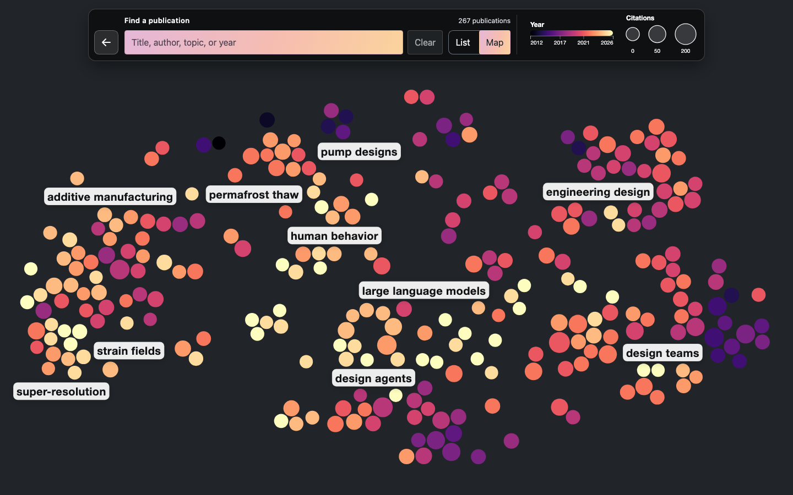

# Publication map method review — 2026-10-29

The previous map was a useful exploratory view, but its final topic memberships
were fitted in the two-dimensional t-SNE projection. That made topic content
depend on visualization distortion. The revised pipeline keeps topic membership
in semantic embedding space and tunes the display separately.

## Input and comparisons

All comparisons used the same 267 papers and 768-dimensional embeddings from
`ccm/publications` commit `0359eb8a8a1ca9dae4e40d43057e63c1b5f60cdb`.
No publications were scraped or re-embedded. Embedding norms ranged from 21.39
to 21.98; raw and normalized PCA retained about 86.3% of variance at 50 dimensions.

Clustering comparisons covered raw and L2-normalized PCA50, K-means k=6, 8, 10,
12, 14, and 16, and seeds 0, 42, 84, 123, and 2026. The initial comparison used
20 starts; the leading k=10 configuration was checked at 50 and 100 starts.
An average-linkage cosine alternative produced groups of 2–177 papers and was
rejected for this map's thematic granularity. Six K-means groups merged too many
topics, while finer partitions were less stable or created very small groups.

Projection comparisons covered perplexities 15, 25, 30, 40, 50, and 60, raw and
normalized PCA preprocessing, direct cosine embeddings, PCA initialization,
and 2,000 iterations. Leading settings were checked across seeds and in the
actual browser layout, including its label obstacles and bubble spacing.
KL divergence was not compared across perplexities as a common quality scale.

## Selected settings and evidence

- Topics: raw embedding PCA50 with full SVD; K-means k=10, n_init=100, seed=42.
- Display: L2 normalization, full-SVD PCA50, cosine-distance t-SNE,
  perplexity=40, max_iter=2000, learning_rate=auto. Initialization uses the
  normalized embeddings' full-SVD first two principal components scaled to
  1e-4. Computations use float64 input and float32 initialization explicitly.
- Titles: the same automatic paper-supported phrase scorer.

With its explicit PCA start, the selected projection produced identical
coordinates at seeds 0, 42, and 84 on the review host.

| Diagnostic | Previous committed map | Selected build |
| --- | ---: | ---: |
| Original-space cosine silhouette | 0.0997 | 0.1421 |
| Nearest-10 semantic neighbors in the same topic | 62.4% | 70.0% |
| Raw projection trustworthiness, k=10 | 0.9111 | 0.9268 |
| Raw projection nearest-10 retention | 52.1% | 54.8% |
| Rendered map trustworthiness, k=10 | 0.9049 | 0.9222 |
| Rendered map nearest-10 retention | 50.3% | 52.8% |
| 95th percentile bubble displacement from projected position | 32.4 px | 22.6 px |

Rendered measurements use the 1440×900 browser view. Topic grouping comparisons
use cosine distances in the original embeddings, rather than the 2D map.
Across matched seeds 0, 42, and 84, semantic k=10 with 100 starts had mean
adjusted Rand agreement 0.739, compared with 0.527 for legacy projection
refinements. Across all five semantic clustering seeds, agreement was 0.706.
Stability is moderate: this is a useful thematic partition of
overlapping research interests, not evidence of ten uniquely true categories.

The selected groups have 12–54 papers. Automatic titles include design agents,
large language models, human behavior, additive manufacturing, permafrost thaw,
super-resolution, and strain fields. Browser and export tests still require
every publication and label to fit without overlap.

## Interpretation and regression coverage

Trustworthiness penalizes unexpected neighbors in the projected map; nearest-10
retention directly counts original neighbors retained. The gains are useful but
modest, and no 2D map preserves every relationship. t-SNE's region sizes and
inter-region distances should not be read as quantitative semantic measurements.
Color continues to show publication year and bubble size shows citation count.

Tests check planted-topic recovery, local projection fidelity, deterministic
results, and invariant topic memberships when display coordinates are scrambled.
Snapshot provenance records the selected parameters and quality measurements.
Future refreshes should inspect topic titles, sizes, and diagnostics rather than
optimize for dramatic visual separation.

An upstream follow-up is worth benchmarking separately: the current scraper
uses the SPECTER2 base model's CLS vector. AllenAI recommends its proximity
adapter for general paper embeddings and nearest-neighbor tasks. That would
require re-embedding the complete collection consistently; this review kept
the existing vectors fixed. See the [AllenAI model card](https://huggingface.co/allenai/specter2_base).

Primary references: [scikit-learn t-SNE guidance](https://scikit-learn.org/stable/modules/generated/sklearn.manifold.TSNE.html),
[trustworthiness definition](https://scikit-learn.org/stable/modules/generated/sklearn.manifold.trustworthiness.html),
and [How to Use t-SNE Effectively](https://distill.pub/2016/misread-tsne/).
