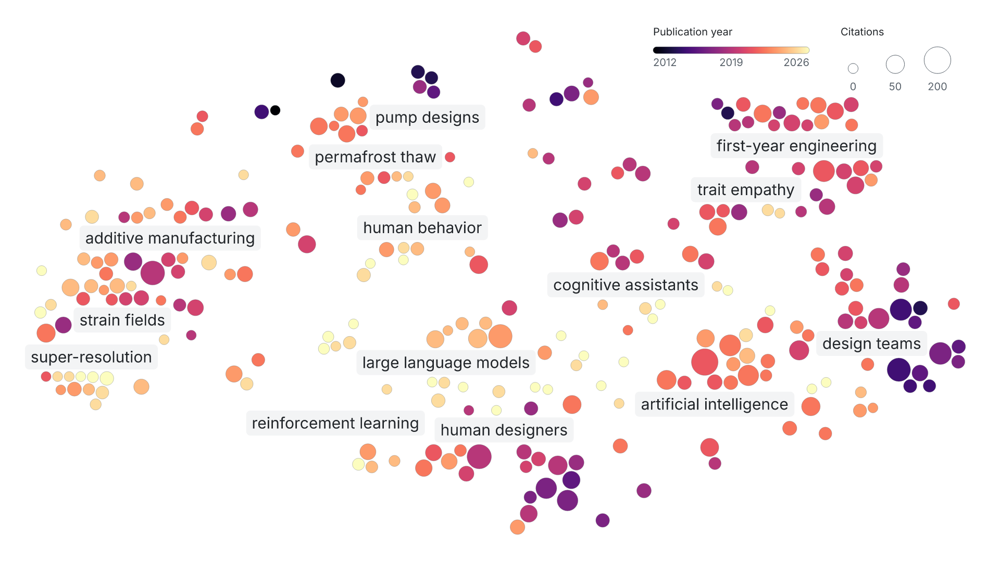

# Publication map method review — 2026-10-30

The map needs titles that describe coherent research topics and cover the
neighborhoods visible on screen. Refitting clusters in a two-dimensional t-SNE
projection is a valid way to improve that visual coverage, with a tradeoff:
topic membership can also follow projection distortions. Semantic clustering
better preserves the embedding structure, but its groups may span several
displayed regions. The current policy starts with semantic topics, splits
oversized groups using both semantic and visual distances, and checks the
resulting groups for well-separated visual islands with semantic support.

## Input and comparisons

All comparisons used the same 267 papers and 768-dimensional embeddings from
`ccm/publications` commit `0359eb8a8a1ca9dae4e40d43057e63c1b5f60cdb`.
No publications were scraped or re-embedded. Embedding norms ranged from 21.39
to 21.98; raw and normalized PCA retained about 86.3% of variance at 50 dimensions.

Clustering comparisons covered raw and L2-normalized PCA50, K-means k=6, 8, 10,
12, 14, and 16, and seeds 0, 42, 84, 123, and 2026. The initial comparison used
20 starts; the leading k=10 configuration was checked at 50 and 100 starts.
An average-linkage cosine alternative produced groups of 2–177 papers and was
rejected for this map's thematic granularity. Six K-means groups merged too many
topics, while finer partitions were less stable or created very small groups.

Projection comparisons covered perplexities 15, 25, 30, 40, 50, and 60, raw and
normalized PCA preprocessing, direct cosine embeddings, PCA initialization,
and 2,000 iterations. Leading settings were checked across seeds and in the
actual browser layout, including its label obstacles and bubble spacing.
KL divergence was not compared across perplexities as a common quality scale.

## Current size and proximity policy

The base partition uses raw embedding PCA50 with full SVD and K-means k=10,
n_init=100, seed=42. A topic may contain at most one eighth (12.5%) of the
collection. The integer limit is `max(1, floor(record_count / 8))`; only parents
larger than that limit are split. Each receives
`ceil(parent_size / size_limit)` children, and papers stay within their base
semantic parent.

The size-split objective combines 75% semantic PCA squared distance with 25% squared
distance in the existing 2D map. Both coordinate blocks are centered and scaled
to unit root mean square radius over the full collection before weighting.
Local K-means uses 20 starts with alternating centroid updates and Hungarian
capacity assignment. Every child must contain at least
`max(1, floor(parent_size / (2 * children)))` papers and at most the size limit.
These bounds allow natural unequal subdivisions while preventing tiny outlier
children.

For this collection of 267 papers, the cap is 33. Four parents first split the ten
base topics into fourteen groups of 9–33 papers:

| Base topic | Papers | Automatically titled children |
| --- | ---: | --- |
| engineering design | 37 | first-year engineering (17); trait empathy (20) |
| design teams | 54 | artificial intelligence (21); design teams (33) |
| large language models | 38 | large language models (18); cognitive assistants (20) |
| design agents | 37 | reinforcement learning (9); human designers (28) |

After size splitting, every group with at least six papers receives one
candidate two-way split in the same 75% semantic / 25% visual space. Each
candidate child needs at least two papers. A split is accepted only when its
two-dimensional silhouette is at least 0.60, its 90th-percentile distance to
the nearest child centroid falls at least 35% relative to the unsplit group,
and its silhouette in the original embeddings' cosine space is at least 0.30.
Each group is checked once; the larger child retains its previous ID. This
lets clear display islands separate while rejecting a t-SNE gap that lacks
semantic support. The thresholds were checked against all fourteen groups in
the pinned snapshot. Generated titles must still pass the existing distinct,
paper-supported phrase check.

The reinforcement-learning group alone passes all three checks. Its two
Stackelberg game papers become a separate neighborhood. Their automatically
derived title was “stochastic stackelberg game,” which accurately names the
method but gave a two-paper group an outsized, specialized map label. The
reviewed snapshot uses the clearer “robust design” name for this exact pair
and does not show a visible map label for groups of fewer than three papers.
The remaining seven-paper group keeps
“reinforcement learning”; five papers clearly discuss RL and two concern
drone design data or prediction. The map now has fifteen groups of 2–33
papers. An exclusive map neighborhood remains an imperfect subject tag for
an individual paper, so the browser searches each paper's own text rather
than automatically treating the neighborhood name as its keyword.

Titles are first re-derived from publication evidence after splitting with the
paper-supported phrase scorer. The only editorial override is the exact
two-paper robust-design group; its stable publication IDs and rationale are
recorded in the snapshot metadata. The scorer's source phrases are otherwise
unchanged. All fifteen groups remain in the data and in paper details; fourteen
have visible labels on the map.

The t-SNE settings below and the existing projected coordinates are retained.
Only oversized parents and groups passing the proximity check use the projection
during local refinement. This keeps visual coverage in the clustering objective
without refitting the entire collection to the map. Splits change membership,
titles, and label centroids; they do not move publications.

The [previous size-only map](screenshots/size-capped-topics.png) shows the
reinforcement-learning label before the Stackelberg island separated.

## Historical 0.2.15 comparison

The following settings and measurements describe the 0.2.15 build, before the
size policy above. That build replaced a complete projection-space refit with
ten semantic topics and retuned the display. Its metrics remain useful evidence
about projection fidelity and the tradeoff between semantic and visual grouping;
they do not describe the current fifteen-topic partition.

- Topics: raw embedding PCA50 with full SVD; K-means k=10, n_init=100, seed=42.
- Display: L2 normalization, full-SVD PCA50, cosine-distance t-SNE,
  perplexity=40, max_iter=2000, learning_rate=auto. Initialization uses the
  normalized embeddings' full-SVD first two principal components scaled to
  1e-4. Computations use float64 input and float32 initialization explicitly.
- Titles: the same automatic paper-supported phrase scorer.

With its explicit PCA start, the selected projection produced identical
coordinates at seeds 0, 42, and 84 on the review host.

| Diagnostic | Map before 0.2.15 | 0.2.15 (10 semantic topics) |
| --- | ---: | ---: |
| Original-space cosine silhouette | 0.0997 | 0.1421 |
| Nearest-10 semantic neighbors in the same topic | 62.4% | 70.0% |
| Raw projection trustworthiness, k=10 | 0.9111 | 0.9268 |
| Raw projection nearest-10 retention | 52.1% | 54.8% |
| Rendered map trustworthiness, k=10 | 0.9049 | 0.9222 |
| Rendered map nearest-10 retention | 50.3% | 52.8% |
| 95th percentile bubble displacement from projected position | 32.4 px | 22.6 px |

Rendered measurements use the 1440×900 browser view. Topic grouping comparisons
use cosine distances in the original embeddings, rather than the 2D map.
Across matched seeds 0, 42, and 84, semantic k=10 with 100 starts had mean
adjusted Rand agreement 0.739, compared with 0.527 for legacy projection
refinements. Across all five semantic clustering seeds, agreement was 0.706.
Stability is moderate: this is a useful thematic partition of
overlapping research interests, not evidence of ten uniquely true categories.

The 0.2.15 groups had 12–54 papers. Automatic titles included design agents,
large language models, human behavior, additive manufacturing, permafrost thaw,
super-resolution, and strain fields. Browser and export tests still require
every publication and label to fit without overlap.

## Interpretation and regression coverage

Trustworthiness penalizes unexpected neighbors in the projected map; nearest-10
retention directly counts original neighbors retained. The gains are useful but
modest, and no 2D map preserves every relationship. t-SNE's region sizes and
inter-region distances should not be read as quantitative semantic measurements.
Color continues to show publication year and bubble size shows citation count.

Tests check planted-topic recovery, local projection fidelity, deterministic
results, size bounds, and preservation of parent membership. Compact topics
already under the cap stay intact when display coordinates change; larger or
disconnected topics can respond to visual neighborhoods. A tied-semantic fixture
checks that size splits can respect separate display regions, and a second
fixture rejects a visual split without original-space semantic support. Snapshot
provenance records the selected parameters and quality measurements. Future
refreshes should inspect topic titles, sizes, semantic diagnostics, and visual
coverage together rather than optimize for dramatic visual separation.

An upstream follow-up is worth benchmarking separately: the current scraper
uses the SPECTER2 base model's CLS vector. AllenAI recommends its proximity
adapter for general paper embeddings and nearest-neighbor tasks. That would
require re-embedding the complete collection consistently; this review kept
the existing vectors fixed. See the [AllenAI model card](https://huggingface.co/allenai/specter2_base).

Primary references: [scikit-learn t-SNE guidance](https://scikit-learn.org/stable/modules/generated/sklearn.manifold.TSNE.html),
[trustworthiness definition](https://scikit-learn.org/stable/modules/generated/sklearn.manifold.trustworthiness.html),
and [How to Use t-SNE Effectively](https://distill.pub/2016/misread-tsne/).
